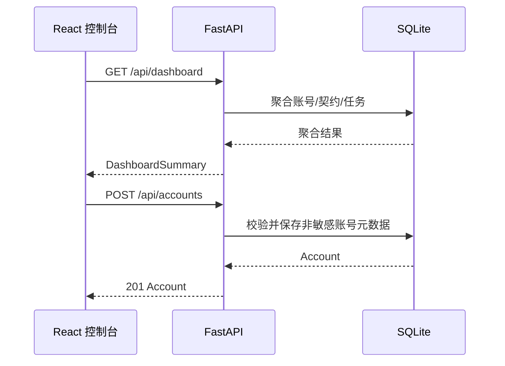

# Flame Contractor 本地控制平面 API 文档

> 版本：0.1.0 | 接口状态：本机控制台当前实现

## 1. 通用规范

### 1.1 接口概述

本文档描述本机 React 控制台与本机 FastAPI 控制平面之间的数据交换。接口由 Flame Contractor 后端提供，前端调用。

骨架 API 只管理非敏感元数据，不接收抖音 Cookie、密码、Token 或 Storage State。

### 1.2 接口规范

- **开发 Base URL**：`http://127.0.0.1:8000/api`
- **协议**：HTTP（仅本机）；未来远程模式必须 HTTPS
- **编码**：UTF-8
- **请求格式**：`application/json`
- **响应格式**：`application/json`
- **OpenAPI**：`http://127.0.0.1:8000/docs`

### 1.3 鉴权

除健康检查、初始化状态、一次性管理员初始化和登录外，业务接口都要求：

```http
Authorization: Bearer <session-token>
```

令牌关联可撤销的服务端登录会话。登出、用户改密、管理员重置密码或主动退出设备后，对应会话立即失效。服务仍只监听回环地址，不得暴露到公网。

### 1.4 错误格式

FastAPI 校验或业务错误：

```json
{
  "detail": "错误说明"
}
```

| HTTP 状态 | 含义 |
|---|---|
| 200 | 查询/更新成功 |
| 201 | 创建成功 |
| 400 | 请求不符合账号安全规则 |
| 401 | 未登录、令牌无效或会话已失效 |
| 403 | 当前用户没有管理员权限 |
| 404 | 资源不存在 |
| 409 | 名称或业务唯一键冲突 |
| 422 | 请求字段校验失败或包含禁止字段 |
| 500 | 未处理的系统异常 |

## 2. 接口交互



### 2.1 平台账号认证

| 接口 | 方法 | 鉴权 | 说明 |
|---|---|---|---|
| `/auth/setup` | GET | 否 | 返回 `{ "needsSetup": boolean }`，供登录页判断是否进入首启初始化 |
| `/auth/register` | POST | 否 | 仅当用户表为空时创建首位管理员并签发会话；初始化后返回 409 |
| `/auth/login` | POST | 否 | 用户名和密码登录并签发新会话 |
| `/auth/me` | GET/PATCH | 是 | 读取或更新当前用户资料 |
| `/auth/me/password` | POST | 是 | 校验当前密码并设置至少 8 位的新密码，同时撤销其它会话 |
| `/auth/logout` | POST | 是 | 撤销当前会话 |
| `/auth/sessions` | GET | 是 | 列出当前用户的登录会话 |
| `/auth/sessions/{id}` | DELETE | 是 | 撤销当前用户的指定会话 |
| `/auth/users` | GET/POST | 管理员 | 列出用户或创建平台用户；新用户密码至少 8 位 |
| `/auth/users/{id}` | PATCH | 管理员 | 重置密码或调整管理员权限；系统至少保留一名管理员 |

`POST /auth/register` 不是公开注册接口，只承担全新安装的一次性初始化。自托管版本忘记密码时由平台管理员在「我的账号」中重置。

## 3. 健康与总览

### 3.1 健康检查

- **接口说明**：确认 API 与数据库已就绪。
- **请求 URL**：`/health`
- **请求方式**：GET
- **接口提供方**：Flame Contractor 后端
- **接口调用方**：本地控制台/开发者

#### 响应示例

```json
{
  "status": "ok",
  "app": "Flame Contractor",
  "version": "0.1.0",
  "database": "ready"
}
```

### 3.2 查询总览

- **接口说明**：返回控制台首页聚合数据。
- **请求 URL**：`/dashboard`
- **请求方式**：GET
- **接口提供方**：Flame Contractor 后端
- **接口调用方**：本地控制台

#### 响应字段

| 名称 | 字段属性 | 类型 | 必填 | 含义 |
|---|---|---|---|---|
| 账号总数 | accountCount | integer | 是 | 所有账号数 |
| 健康账号 | healthyAccountCount | integer | 是 | 状态为 healthy 的账号数 |
| 启用契约 | activeContractCount | integer | 是 | 启用中的契约对象数 |
| 今日成功 | todaySucceeded | integer | 是 | 当地日期成功任务数 |
| 今日待执行 | todayPending | integer | 是 | scheduled/leased 等未终态任务数 |
| 需人工处理 | needsAttention | integer | 是 | 账号或任务异常数 |
| 账号列表 | accounts | Account[] | 是 | 首页账号摘要 |
| 最近任务 | recentJobs | SendJob[] | 是 | 最近任务，默认最多 8 条 |

### 3.3 查询调度与会话状态自动同步

- **接口说明**：返回今日发送计划，以及每个账号的后台会话状态自动同步计划。
- **请求 URL**：`/scheduler`
- **请求方式**：GET
- **自动同步默认策略**：服务启动后首次等待约 1 分钟，此后默认每 24 小时一次；自动扫描避开发送窗口开始前 15 分钟至窗口结束。周期可在总览设置为 1–168 小时并持久化到 SQLite；后端环境变量 `FLAME_AUTO_SCAN_INTERVAL_HOURS` 仅在没有持久化设置时作为初始默认值。
- 自动同步只刷新数据库中已经存在的契约对象官方状态，不自动新增会话、不发送消息；手动扫描接口仍可单独触发。自动任务执行期间，前端可通过返回的 `taskId` 读取同一份扫描进度，在全局任务坞中查看真实处理数和百分比；它不提供手动扫描的导入、取消或重试操作。

#### 响应新增字段

| 名称 | 字段属性 | 类型 | 含义 |
|---|---|---|---|
| 自动同步间隔 | autoScanIntervalHours | integer | 自动会话扫描周期，单位小时，默认 24 |
| 账号自动同步状态 | autoScans | AutoScanStatus[] | 每个账号的最近一次与下一次同步状态 |
| 当前自动任务 | autoScans[].taskId | string/null | `running` 时对应的扫描任务 ID；其他状态通常为 `null` |

`autoScans[].status` 取值：

| 值 | 含义 |
|---|---|
| scheduled | 已排期，`nextScanAt` 为下一次触发时间 |
| due | 已到触发时间，等待调度器启动同步 |
| running | 正在读取会话列表；`taskId` 可用于读取进度并在前端任务坞中观察 |
| paused | 全局自动调度已暂停 |
| waiting_login | 账号未处于可用登录状态 |
| disabled | 账号已停用 |
| no_targets | 暂无契约对象 |

`lastScanAt` 和 `nextScanAt` 为 ISO 8601 时间；暂停、停用、未登录或无契约对象时，下一次时间可能为 `null`。`POST /scheduler/pause` 与 `POST /scheduler/resume` 返回同样的调度状态结构；暂停会同时暂停自动发送与自动会话同步，但不影响手动操作。

### 3.4 更新会话状态自动同步周期

- **接口说明**：更新后台会话列表自动同步的间隔，不会立即触发扫描，也不会发送消息。
- **请求 URL**：`/scheduler/settings`
- **请求方式**：PATCH
- **请求体**：`{"autoScanIntervalHours": 1}`
- **有效范围**：`1–168` 小时（含边界）；控制台提供常用周期选项，允许每小时一次但不建议作为默认值。
- **持久化**：写入已有 `AppSetting` 键 `scheduler.auto_scan_interval_hours`，重启后恢复；更新成功后从下一次调度判断开始按新间隔计算。

## 4. 账号接口

### 4.1 查询账号

- **请求 URL**：`/accounts`
- **请求方式**：GET

响应：`Account[]`。

### 4.2 创建账号

- **接口说明**：创建本地账号元数据；不执行登录。
- **请求 URL**：`/accounts`
- **请求方式**：POST

#### 请求参数

| 名称 | 字段属性 | 类型 | 必填 | 含义 |
|---|---|---|---|---|
| 显示名称 | displayName | string(1..60) | 是 | 本机用于识别账号的名称，唯一 |
| 时区 | timezone | string | 否 | 默认 `Asia/Shanghai` |
| 发送窗口起点 | sendWindowStart | `HH:mm` | 否 | 默认 `20:00` |
| 发送窗口终点 | sendWindowEnd | `HH:mm` | 否 | 默认 `22:00` |

#### 请求示例

```json
{
  "displayName": "主账号",
  "timezone": "Asia/Shanghai",
  "sendWindowStart": "20:00",
  "sendWindowEnd": "22:00"
}
```

#### 成功响应（201）

```json
{
  "id": "25ebd541-85ae-44d4-bec2-33c4779fc7cf",
  "displayName": "主账号",
  "status": "pending_login",
  "enabled": true,
  "timezone": "Asia/Shanghai",
  "sendWindowStart": "20:00",
  "sendWindowEnd": "22:00",
  "lastVerifiedAt": null,
  "lastSuccessAt": null,
  "createdAt": "2026-08-26T15:30:00+08:00"
}
```

#### 禁止字段

请求体含下列或任何未声明字段将返回 422：

```text
password, cookie, token, storageState, profilePath
```

### 4.3 更新账号状态

- **接口说明**：骨架阶段允许启停与暂停，不允许伪造 `healthy/running`。
- **请求 URL**：`/accounts/{accountId}`
- **请求方式**：PATCH

#### 请求参数

| 名称 | 字段属性 | 类型 | 必填 | 含义 |
|---|---|---|---|---|
| 是否启用 | enabled | boolean | 否 | false 时账号不参与任务 |
| 状态 | status | enum | 否 | 当前仅允许 `pending_login` 或 `paused` |
| 发送窗口起点 | sendWindowStart | `HH:mm` | 否 | 本地时间 |
| 发送窗口终点 | sendWindowEnd | `HH:mm` | 否 | 本地时间 |

## 5. 契约对象接口

### 5.1 查询契约对象

- **请求 URL**：`/targets?accountId={accountId}`
- **请求方式**：GET
- `accountId` 可选；存在时按账号过滤。

### 5.2 创建契约对象

- **请求 URL**：`/targets`
- **请求方式**：POST

#### 请求参数

| 名称 | 字段属性 | 类型 | 必填 | 含义 |
|---|---|---|---|---|
| 账号 ID | accountId | UUID | 是 | 所属账号 |
| 昵称快照 | nicknameSnapshot | string(1..80) | 是 | 当前识别名称；未来绑定稳定 ID 后仅作展示 |
| 平台用户 ID | platformUserId | string | 否 | 内部稳定 ID（通常为 sec_uid），获得后优先匹配；不建议当作可读抖音号展示 |
| 可读平台号 | platformHandle | string | 否 | 抖音 `unique_id`，缺失时回退 `short_id`；仅用于展示 |
| 群会话 ID | platformConversationId | string | 否 | 群聊在抖音会话 protobuf 中的稳定唯一 ID；与 platformUserId 二选一 |
| 会话类型 | conversationType | `user` / `group` | 否 | 有群会话 ID 时默认为 `group`；群聊发送核对使用会话 ID |
| 模板 ID | templateId | UUID | 否 | 绑定模板 |
| 展示火花天数 | streakDays | integer>=0 | 否 | 默认 0 |

账号不存在、模板不存在返回 404；同账号昵称或同一稳定身份重复返回 409。用户身份和群会话身份不能混填。

查询契约对象时，响应还包含 `sparkDays`、`sparkKind`、`sparkLabel`、`sparkScannedAt` 四个官方火花状态快照字段；它们只用于展示最近一次会话扫描结果，不参与发送决策。`streakDays` 仍是本地累计值，不能与 `sparkDays` 混用。

### 5.3 局部更新契约对象

- **请求 URL**：`/targets/{id}`
- **请求方式**：PATCH
- 可更新 `enabled`、`templateId`、`sendTimeHhmm`，以及官方展示快照 `sparkDays`/`sparkLabel`。
- `sparkDays` 与 `sparkLabel` 互斥；提交任一官方状态字段时会刷新 `sparkScannedAt`，且绝不改写本地 `streakDays`。
- `streakDays` 不接受通过 PATCH 手动校准；本地累计只由初始导入和已确认发送业务维护。

## 6. 模板接口

### 6.1 查询模板

- **请求 URL**：`/templates`
- **请求方式**：GET

### 6.2 创建模板

- **请求 URL**：`/templates`
- **请求方式**：POST

#### 请求参数

| 名称 | 字段属性 | 类型 | 必填 | 含义 |
|---|---|---|---|---|
| 模板名称 | name | string(1..60) | 是 | 唯一名称 |
| 模板内容 | content | string(1..1000) | 是 | 纯文本及安全变量 |
| 模板类型 | type | enum | 否 | `text` / `image` / `sticker`，默认 `text` |
| 图片路径 | imagePath | string(500) | 否 | `image` 类型必填，本地图片路径 |
| 表情名称 | stickerName | string(64) | 否 | `sticker` 类型必填，表情面板按此名称匹配 |
| 表情显示名 | stickerLabel | string(64) | 否 | 面板显示名，默认=stickerName |
| 表情分类 | stickerCategory | string(32) | 否 | 表情分类，打开面板先定位该分类 |
| 表情兜底索引 | stickerFallbackIndex | integer | 否 | 面板内第 n 个可点元素的兜底索引 |

允许变量：

```text
{{target_name}} {{streak_days}} {{weekday}} {{date}}
```

发现未知变量或代码片段时返回 422。

#### 请求示例

```json
{
  "name": "每日一言",
  "content": "{{target_name}}，今天也要开心。第 {{streak_days}} 天，焰不可熄。"
}
```

## 7. 执行接口（M2）

> 真实浏览器操作只在本机进行；登录与 Dry Run 均不向服务端发送凭据文本。

### 7.1 发起扫码登录

- **接口说明**：在本机打开该账号的独立浏览器窗口（headed），等待本人扫码。同一账号同时只允许一个登录流程。
- **请求 URL**：`/accounts/{accountId}/login`
- **请求方式**：POST
- **返回**：`202`

响应示例：

```json
{ "state": "waiting_scan", "detail": null }
```

重复发起返回 `409`；账号不存在返回 `404`。

### 7.2 查询登录状态

- **请求 URL**：`/accounts/{accountId}/login`
- **请求方式**：GET

`state` 取值：

| 值 | 含义 |
|---|---|
| idle | 没有登录流程 |
| waiting_scan | 浏览器已打开，等待扫码 |
| succeeded | 已登录，账号状态更新为 healthy |
| expired | 等待扫码超时 |
| failed | 流程异常终止 |

### 7.3 取消登录流程

- **请求 URL**：`/accounts/{accountId}/login/cancel`
- **请求方式**：POST
- 关闭浏览器并结束轮询。

### 7.4 执行 Dry Run

- **接口说明**：以 headless 方式复用该账号的浏览器 Profile，逐一严格定位契约对象；**绝不发送任何消息**。登录失效时把账号标记为 `auth_expired`。登录流程进行中返回 `409`。
- **请求 URL**：`/accounts/{accountId}/dry-run`
- **请求方式**：POST

响应示例：

```json
{
  "accountId": "25ebd541-85ae-44d4-bec2-33c4779fc7cf",
  "overall": "ok",
  "detail": null,
  "targets": [
    { "target": "好友A", "status": "found", "title": "好友A" },
    { "target": "好友A同学", "status": "ambiguous", "title": "好友A" },
    { "target": "不存在", "status": "not_found", "title": null }
  ],
  "artifactPath": "D:/Workspace/Flame Contractor/artifacts/<accountId>/dry-run-20260826-153000.json"
}
```

`overall`：`ok` / `auth_expired` / `error`；`targets[].status`：`found` / `not_found` / `ambiguous`。

### 7.5 发送预览

- **接口说明**：返回当前账号全部启用契约对象及本次渲染的消息，不读取或消耗发送幂等记录。
- **请求 URL**：`/accounts/{accountId}/send/preview`
- **请求方式**：GET

### 7.6 手动发送

- **请求 URL**：`/accounts/{accountId}/send`
- **请求方式**：POST
- **查询参数**：`force`，boolean，可选，默认 `false`。

| 模式 | 说明 |
|---|---|
| `force=false` | 普通发送；同账号、好友、业务日期、模板版本已有成功任务时返回 `duplicate_succeeded`，不再发送。自动调度只使用此模式。 |
| `force=true` | 仅手动入口使用；处理全部启用对象，即使当天同一模板版本已有成功记录，并以带 `:force:` 标记的独立 `message_slot_id` 记录本次任务。 |

两种模式都必须通过登录、网络、模板、好友/群会话身份和发送终态确认；`unknown_requires_review` 会跨任务槽位阻止当天再次发送，必须先人工执行 `confirm-sent` 或 `release`。强制模式不会绕过身份存疑、未知结果、账号暂停、登录失效或网络不可用，也不会改变自动调度的发送策略。响应结构与普通 `SendRead` 相同。

### 7.7 单好友强制发送

- **接口说明**：对指定契约对象（好友/群聊）手动强制发送，可选择模板，也可直接输入文本（二选一）。始终绕过当天同账号/好友/业务日期的成功记录，并为本次运行创建独立 `:force:` 审计槽位。
- **请求 URL**：`/accounts/{accountId}/targets/{targetId}/send`
- **请求方式**：POST
- **请求体**：`SendTargetPayload`（`template_id` 与 `content` 至少提供一项，且互斥）

| 字段 | 类型 | 必填 | 说明 |
|---|---|---|---|
| template_id | string | 否 | 模板 ID；与 `content` 二选一 |
| content | string | 否 | 直接输入的文本，最长 1000 字符；与 `template_id` 二选一 |

当使用直接文本时，`SendJob` 不引用模板（`template_id` 为空），任务槽位以内容哈希命名（`raw:<sha1[:12]>:force:<runId>`），避免超出槽位长度上限。

- **响应**：与 `SendRead` 相同。

其余安全边界同 7.6：必须通过登录、网络、好友身份和发送终态确认；不绕过 `unknown_requires_review`、账号暂停、登录失效或网络不可用。

## 8. 枚举

### 7.1 AccountStatus

| 编码 | 说明 |
|---|---|
| pending_login | 尚未建立抖音登录会话 |
| healthy | 会话健康 |
| running | Worker 正在执行 |
| paused | 用户暂停 |
| auth_expired | 登录失效 |
| verification_required | 需本人验证 |
| dom_broken | 页面结构不兼容 |
| cooldown | 临时冷却 |

### 7.2 JobStatus

| 编码 | 说明 |
|---|---|
| scheduled | 已调度 |
| leased | Worker 已租用 |
| opening_chat | 正在打开目标会话 |
| sending | 已触发发送 |
| confirming | 正在确认发送终态 |
| succeeded | 已确认成功 |
| failed_retryable | 可安全重试 |
| failed_terminal | 终止失败 |
| unknown_requires_review | 结果未知，必须人工检查 |
| cancelled | 已取消 |

## 8. 联调注意事项

- 前端字段统一使用 camelCase；数据库字段使用 snake_case；
- 时间戳为带时区 ISO 8601；
- 日期幂等按账号配置时区计算；
- 发送与会话扫描 API 的真实执行依赖抖音页面结构、登录态和本机 Playwright；假浏览器测试不能替代实机验证；
- 不要在请求、日志、Issue 或截图中粘贴真实账号凭据。

## 9. Selector Bundle 热更新

> 抖音页面可随时改版。选择器已外置为 `app/execution/selectors_bundle.json`（运行时唯一来源），编辑后调用重载即可生效，**无需重启后端进程**。

### 9.1 查询当前 selector bundle

- **请求 URL**：`/selectors`
- **请求方式**：GET
- **返回**：当前 bundle 全量快照（纯选择器字符串/字符串数组，不含任何凭据）。

```json
{
  "file_path": "D:/Workspace/Flame Contractor/backend/app/execution/selectors_bundle.json",
  "count": 16,
  "loaded_mtime": 1724820000.0,
  "selectors": {
    "CHAT_EDITOR": "div[data-slate-editor=\"true\"][contenteditable=\"true\"]",
    "SEND_BUTTONS": ["[class*=\"messageMsgInputpublishBtn\"]", ".e2e-send-msg-bt"]
  }
}
```

### 9.2 强制重载 selector bundle

- **接口说明**：立即重新读取 `selectors_bundle.json` 并刷新进程内快照。bundle 本身还会在每次访问时惰性检查 mtime，因此本端点仅为「立刻、显式」刷新提供入口。
- **请求 URL**：`/selectors/reload`
- **请求方式**：POST
- **返回**：重载后的 bundle 全量快照（同 9.1）。

### 安全边界

本组端点**只读**当前 bundle / **触发重载**；不接收任何凭据或脚本。选择器 JSON 中只允许字符串与字符串数组字段，避免注入任意对象。改版后必须真机复核。

---

## M6–M8 新增端点（2026-08-30）

### 统计（/api/stats）
- `GET /api/stats/summary?days=30`：按日聚合（total/succeeded/failed/unknown）、
  当前与最长连续成功天数、总成功率；`days` 上限 365。
- `GET /api/stats/export.csv`：任务记录 CSV 附件（Content-Disposition attachment）。

### 备份（/api/backup）
- `GET /api/backup`：全量导出 JSON（`schema_version=1`；accounts/templates(+pool_items)/
  targets/schedules/jobs/attempts；不含凭据）。
- `POST /api/backup/import`：按 id upsert 导入（空库=完整恢复，已有库=无损合并）；
  schema_version 不支持时 422。

### 截图扫码登录（/api/accounts/{id}/login/qr*）
- `POST /api/accounts/{id}/login/qr`：发起 headless 截图扫码（202）。
- `GET /api/accounts/{id}/login/qr`：状态 + `qr_image` 截图路径。
- `GET /api/accounts/{id}/login/qr/image`：二维码 PNG（`Cache-Control: no-store`，
  前端轮询刷新；未生成时 404）。
- `POST /api/accounts/{id}/login/qr/cancel`：取消（与有头登录共用互斥）。

### 模板文案池
- `POST /api/templates`：`type=pool` 时必填 `poolItems: [{content, weekdayMask?, enabled?}]`
  （缺候选 422）；`weekdayMask` 位掩码 0=每天，bit0=周一 … bit6=周日。
- `GET /api/templates`：池模板响应附带 `poolItems`。
- 选取规则：星期过滤后按 `last_used_at` 最早优先（LRU）；发送消耗轮换顺序，预览不消耗。

## CRUD 补齐与好友导入（2026-08-30 深夜）

### 好友（/api/targets）
- `PATCH /api/targets/{id}`：开放 `enabled`、`templateId`（`null`=解绑）、`sendTimeHhmm`，以及互斥的
  `sparkDays`/`sparkLabel` 官方快照校准；不接受 `streakDays`，手动校准不会改写本地累计。
- `POST /api/targets/batch`：批量导入/刷新。`items: [{nickname, platformUserId?, platformHandle?, platformConversationId?, conversationType?, identityStatus?, conversationStatus?, streakDays?, sparkDays?, sparkKind?, sparkLabel?}]`（≤200 条），
  逐条独立提交：新好友进 `created`、普通重名进 `duplicates`、单条失败进 `failed`，不中断整批；
  携带官方状态字段的已有好友更新官方快照并进 `refreshed`，不改写本地 `streakDays`。
  响应中的 `identityBound`、`identityUnresolved`、`identityAmbiguous` 分别说明本批实际写入稳定身份、
  本次没有观察到可安全绑定的身份、以及同名冲突而主动阻止绑定的条目；未观察到不等于用户不存在。
  群聊对应的 `conversationBound`、`conversationUnresolved`、`conversationAmbiguous` 使用同样语义；群聊实际写入的是
  `platformConversationId`，不会把群聊误当成用户 `sec_uid`。
  新好友的 `streakDays` 为扫描读到的官方火花天数，用作本地累计初始值；`sparkDays` 保存本次扫描到的官方数字状态，官方状态原文与扫描时间另存为展示快照。已有好友刷新时只更新 `sparkDays`/`sparkKind`/`sparkLabel`，不改写本地 `streakDays`。

### 模板（/api/templates）
- `PATCH /api/templates/{id}`：局部更新（name/content/imagePath/sticker*/enabled/
  poolItems 整体替换）；`type` 不可改；仅发送内容变化才 version+1（参与当日幂等键）。
- `DELETE /api/templates/{id}`：被好友绑定或任务引用时 409；无引用物理删除（池候选随删）。

### 账号（/api/accounts）
- `PATCH /api/accounts/{id}`：开放 `displayName`（查重、去空白）。
- `DELETE /api/accounts/{id}`：被好友/任务引用 409、运行中 409；无引用物理删除并清理
  浏览器 Profile；SendSchedule 为派生数据随账号级联清除（不拦截）。

### unknown 任务人工处理（/api/jobs）
- `POST /api/jobs/{id}/confirm-sent`：仅 `unknown_requires_review` 可用（否则 409）；
  对齐自动成功路径（SUCCEEDED + confirmedAt + 火花 +1 + lastSuccessAt）。
- `POST /api/jobs/{id}/release`：回到 SCHEDULED，由「立即发送」重新执行。
- 两个动作均写 SendAttempt（stage=`manual_confirm_sent`/`manual_release`）审计留痕。

### 会话扫描与好友导入（/api/accounts/{id}/scan-chats）
- `POST /api/accounts/{id}/scan-chats`：headless 全量滚动会话列表（只读），返回
  `entries: [{title, platformUserId?, platformHandle?, platformConversationId?, conversationType?, identityStatus, identitySource?, identityCandidateCount, identityDetail?, conversationStatus, conversationCandidateCount, conversationDetail?, preview, streakDays?, streakKind?, streakLabel?}]`。
  - `platformUserId` 是内部稳定身份核对键，`platformHandle` 是可读抖音号；二者均只有在页面响应能安全关联时才返回；
  - `platformConversationId`/`conversationType=group` 来自抖音 `imapi` 的 `get_message_by_init` protobuf；field 1/2 的同一数字 ID、field 3 的群类型和 field 5 的名称会同时校验后才返回；
  - `identityStatus` 为 `bound`（唯一绑定）、`not_observed`（本次响应没有对应身份数据）或 `ambiguous`（多个用户同名）；
    后两种状态不会猜测绑定，也不会据此发送；`identityDetail` 用于解释导入后为什么没有变化；
  - `conversationStatus` 为 `bound`（群名唯一对应一个会话 ID）、`not_observed`（没有观察到带 ID 的群会话）或 `ambiguous`（同名对应多个群会话）；后两种状态不会猜测绑定；
  - 用户会话和群会话分别使用 `platformUserId`、`platformConversationId`；同一条记录不会同时写入两种稳定身份；
  - `streakDays`：抖音官方火花天数（名字旁徽标，数字形态）；
  - `streakLabel`：特殊态文字徽标（「重燃中 1/3」「N 天后消失」）；
  - `streakKind`：`normal`/`couple`/`family`（取自火花图标路径）；
  - 判定续火对象 = 有火花天数 || 有文字徽标 || 最后消息提及「火花」（断火提醒形态）。
  - 登录失效返回 `overall=auth_expired` 并标记账号。
- `POST /api/accounts/{id}/scan-chats/start`：发起后台扫描，返回 `202` 和 `taskId`；
  浏览器扫描不绑定前端页面，控制台切换页面或关闭前端面板后仍可继续观察。任务进度和已发现条目会持久化到 SQLite。
- `GET /api/accounts/{id}/scan-chats/progress?taskId={taskId}`：读取扫描进度；手动扫描返回 `source=manual`，自动同步返回 `source=automatic`。
  扫描完成前 `total` 为 `null`，`completed` 表示当前已发现的会话数，另返回真实阶段、
  当前会话和滚动轮次；扫描过程中 `entries` 会返回当前已发现的条目，完成时
  `status=completed`、`total=completed`，并返回最终结果。
- `GET /api/accounts/{id}/scan-chats/latest`：读取该账号最近一次扫描快照；用于页面刷新、
  前端重连或后端重启后恢复任务坞。没有历史任务时返回 `null`。`running` 只表示当前进程
  仍在执行；后端重启会将遗留任务收束为 `interrupted`，保留已发现条目但不自动续跑。
- `POST /api/accounts/{id}/scan-chats/cancel?taskId={taskId}`：取消指定后台扫描并保留已发现条目；
  已完成、失败、中断或已取消的终态任务重复调用时返回原终态，不会覆盖真实结果。
- 快照响应字段为 `{taskId, accountId, source, status, total, completed, stage, currentItem, round,
  maxRounds, overall, detail, entries, startedAt, finishedAt}`；`status` 取值为
  `running`/`completed`/`failed`/`interrupted`/`cancelled`。
- `source=automatic` 表示调度器发起的只读状态同步；它只回写已有好友/群聊的官方状态，不自动导入新会话、不发送消息。自动同步任务由调度器控制，前端任务坞只提供查看和恢复到好友状态页。
- `failed` 保留 `detail`；`cancelled` 表示用户主动取消；`interrupted` 表示后端停止或重启。
  手动任务的这些状态都不会自动发送或自动导入新好友，用户可查看保留结果并显式重试/手动导入；自动任务只保留结果，不提供重试或导入操作。

### 普通好友身份补采（/api/accounts/{id}/identity-hydration）
- `POST /api/accounts/{id}/identity-hydration/start`：为已有好友中未绑定稳定用户身份的普通好友启动后台补采。
  请求体为 `{targetIds: string[]}`（1–50 个目标 ID）；群聊、已绑定目标和不存在的目标不会进入任务。补采逐个打开精确好友会话，
  只等待本次打开触发的官方用户信息响应，不发送消息；可能将会话标记为已读。
- `GET /api/accounts/{id}/identity-hydration/progress?taskId={taskId}`：读取任务进度和逐项结果。
  响应字段为 `{taskId, accountId, status, total, completed, stage, currentItem, overall, detail, results, startedAt, finishedAt}`；
  `results[].status` 为 `bound`、`not_observed`、`ambiguous` 或 `conflict`，其中后 3 种都不会写入稳定身份。
- `GET /api/accounts/{id}/identity-hydration/latest`：读取该账号最近一次补采快照，用于刷新页面、前端重连或后端重启后恢复任务坞。
  后端重启会把遗留 `running` 收束为 `interrupted`，不自动续跑。
- `POST /api/accounts/{id}/identity-hydration/cancel?taskId={taskId}`：取消正在执行的补采并保留已完成结果；不撤销已经安全写入的身份绑定。
- 补采仅接受好友列表中已存在的普通好友 ID，不从扫描结果猜测目标，不处理群聊；成功绑定时同时保存内部稳定核对键 `platformUserId` 和可读平台号 `platformHandle`（若响应提供）。
