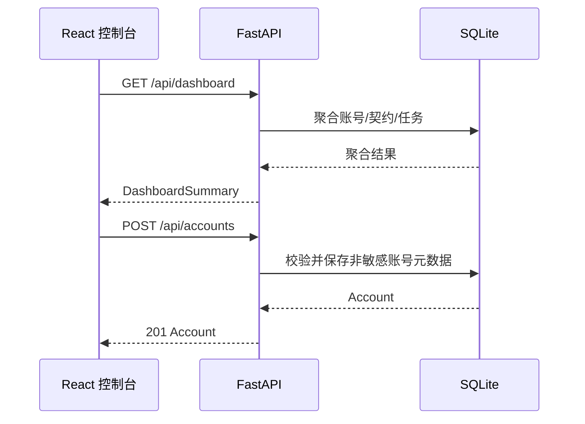

# Flame Contractor 本地控制平面 API 文档

> 版本：0.1.0 | 接口状态：骨架基线

## 1. 通用规范

### 1.1 接口概述

本文档描述本机 React 控制台与本机 FastAPI 控制平面之间的数据交换。接口由 Flame Contractor 后端提供，前端调用。

骨架 API 只管理非敏感元数据，不接收抖音 Cookie、密码、Token 或 Storage State。

### 1.2 接口规范

- **开发 Base URL**：`http://127.0.0.1:8000/api`
- **协议**：HTTP（仅本机）；未来远程模式必须 HTTPS
- **编码**：UTF-8
- **请求格式**：`application/json`
- **响应格式**：`application/json`
- **OpenAPI**：`http://127.0.0.1:8000/docs`

### 1.3 鉴权

本机骨架版本仅监听回环地址，暂不提供用户鉴权。不得将端口暴露到公网。

未来桌面封装将使用本机随机会话令牌与 SameSite Cookie，不沿用当前“无鉴权”开发模式。

### 1.4 错误格式

FastAPI 校验或业务错误：

```json
{
  "detail": "错误说明"
}
```

| HTTP 状态 | 含义 |
|---|---|
| 200 | 查询/更新成功 |
| 201 | 创建成功 |
| 404 | 资源不存在 |
| 409 | 名称或业务唯一键冲突 |
| 422 | 请求字段校验失败或包含禁止字段 |
| 500 | 未处理的系统异常 |

## 2. 接口交互



## 3. 健康与总览

### 3.1 健康检查

- **接口说明**：确认 API 与数据库已就绪。
- **请求 URL**：`/health`
- **请求方式**：GET
- **接口提供方**：Flame Contractor 后端
- **接口调用方**：本地控制台/开发者

#### 响应示例

```json
{
  "status": "ok",
  "app": "Flame Contractor",
  "version": "0.1.0",
  "database": "ready"
}
```

### 3.2 查询总览

- **接口说明**：返回控制台首页聚合数据。
- **请求 URL**：`/dashboard`
- **请求方式**：GET
- **接口提供方**：Flame Contractor 后端
- **接口调用方**：本地控制台

#### 响应字段

| 名称 | 字段属性 | 类型 | 必填 | 含义 |
|---|---|---|---|---|
| 账号总数 | accountCount | integer | 是 | 所有账号数 |
| 健康账号 | healthyAccountCount | integer | 是 | 状态为 healthy 的账号数 |
| 启用契约 | activeContractCount | integer | 是 | 启用中的契约对象数 |
| 今日成功 | todaySucceeded | integer | 是 | 当地日期成功任务数 |
| 今日待执行 | todayPending | integer | 是 | scheduled/leased 等未终态任务数 |
| 需人工处理 | needsAttention | integer | 是 | 账号或任务异常数 |
| 账号列表 | accounts | Account[] | 是 | 首页账号摘要 |
| 最近任务 | recentJobs | SendJob[] | 是 | 最近任务，默认最多 8 条 |

## 4. 账号接口

### 4.1 查询账号

- **请求 URL**：`/accounts`
- **请求方式**：GET

响应：`Account[]`。

### 4.2 创建账号

- **接口说明**：创建本地账号元数据；不执行登录。
- **请求 URL**：`/accounts`
- **请求方式**：POST

#### 请求参数

| 名称 | 字段属性 | 类型 | 必填 | 含义 |
|---|---|---|---|---|
| 显示名称 | displayName | string(1..60) | 是 | 本机用于识别账号的名称，唯一 |
| 时区 | timezone | string | 否 | 默认 `Asia/Shanghai` |
| 发送窗口起点 | sendWindowStart | `HH:mm` | 否 | 默认 `20:00` |
| 发送窗口终点 | sendWindowEnd | `HH:mm` | 否 | 默认 `22:00` |

#### 请求示例

```json
{
  "displayName": "主账号",
  "timezone": "Asia/Shanghai",
  "sendWindowStart": "20:00",
  "sendWindowEnd": "22:00"
}
```

#### 成功响应（201）

```json
{
  "id": "25ebd541-85ae-44d4-bec2-33c4779fc7cf",
  "displayName": "主账号",
  "status": "pending_login",
  "enabled": true,
  "timezone": "Asia/Shanghai",
  "sendWindowStart": "20:00",
  "sendWindowEnd": "22:00",
  "lastVerifiedAt": null,
  "lastSuccessAt": null,
  "createdAt": "2026-08-26T15:30:00+08:00"
}
```

#### 禁止字段

请求体含下列或任何未声明字段将返回 422：

```text
password, cookie, token, storageState, profilePath
```

### 4.3 更新账号状态

- **接口说明**：骨架阶段允许启停与暂停，不允许伪造 `healthy/running`。
- **请求 URL**：`/accounts/{accountId}`
- **请求方式**：PATCH

#### 请求参数

| 名称 | 字段属性 | 类型 | 必填 | 含义 |
|---|---|---|---|---|
| 是否启用 | enabled | boolean | 否 | false 时账号不参与任务 |
| 状态 | status | enum | 否 | 当前仅允许 `pending_login` 或 `paused` |
| 发送窗口起点 | sendWindowStart | `HH:mm` | 否 | 本地时间 |
| 发送窗口终点 | sendWindowEnd | `HH:mm` | 否 | 本地时间 |

## 5. 契约对象接口

### 5.1 查询契约对象

- **请求 URL**：`/targets?accountId={accountId}`
- **请求方式**：GET
- `accountId` 可选；存在时按账号过滤。

### 5.2 创建契约对象

- **请求 URL**：`/targets`
- **请求方式**：POST

#### 请求参数

| 名称 | 字段属性 | 类型 | 必填 | 含义 |
|---|---|---|---|---|
| 账号 ID | accountId | UUID | 是 | 所属账号 |
| 昵称快照 | nicknameSnapshot | string(1..80) | 是 | 当前识别名称；未来绑定稳定 ID 后仅作展示 |
| 平台用户 ID | platformUserId | string | 否 | 稳定 ID，获得后优先匹配 |
| 模板 ID | templateId | UUID | 否 | 绑定模板 |
| 展示火花天数 | streakDays | integer>=0 | 否 | 默认 0 |

账号不存在、模板不存在返回 404；同账号昵称重复返回 409。

## 6. 模板接口

### 6.1 查询模板

- **请求 URL**：`/templates`
- **请求方式**：GET

### 6.2 创建模板

- **请求 URL**：`/templates`
- **请求方式**：POST

#### 请求参数

| 名称 | 字段属性 | 类型 | 必填 | 含义 |
|---|---|---|---|---|
| 模板名称 | name | string(1..60) | 是 | 唯一名称 |
| 模板内容 | content | string(1..1000) | 是 | 纯文本及安全变量 |
| 模板类型 | type | enum | 否 | `text` / `image` / `sticker`，默认 `text` |
| 图片路径 | imagePath | string(500) | 否 | `image` 类型必填，本地图片路径 |
| 表情名称 | stickerName | string(64) | 否 | `sticker` 类型必填，表情面板按此名称匹配 |
| 表情显示名 | stickerLabel | string(64) | 否 | 面板显示名，默认=stickerName |
| 表情分类 | stickerCategory | string(32) | 否 | 表情分类，打开面板先定位该分类 |
| 表情兜底索引 | stickerFallbackIndex | integer | 否 | 面板内第 n 个可点元素的兜底索引 |

允许变量：

```text
{{target_name}} {{streak_days}} {{weekday}} {{date}}
```

发现未知变量或代码片段时返回 422。

#### 请求示例

```json
{
  "name": "每日一言",
  "content": "{{target_name}}，今天也要开心。第 {{streak_days}} 天，焰不可熄。"
}
```

## 7. 执行接口（M2）

> 真实浏览器操作只在本机进行；登录与 Dry Run 均不向服务端发送凭据文本。

### 7.1 发起扫码登录

- **接口说明**：在本机打开该账号的独立浏览器窗口（headed），等待本人扫码。同一账号同时只允许一个登录流程。
- **请求 URL**：`/accounts/{accountId}/login`
- **请求方式**：POST
- **返回**：`202`

响应示例：

```json
{ "state": "waiting_scan", "detail": null }
```

重复发起返回 `409`；账号不存在返回 `404`。

### 7.2 查询登录状态

- **请求 URL**：`/accounts/{accountId}/login`
- **请求方式**：GET

`state` 取值：

| 值 | 含义 |
|---|---|
| idle | 没有登录流程 |
| waiting_scan | 浏览器已打开，等待扫码 |
| succeeded | 已登录，账号状态更新为 healthy |
| expired | 等待扫码超时 |
| failed | 流程异常终止 |

### 7.3 取消登录流程

- **请求 URL**：`/accounts/{accountId}/login/cancel`
- **请求方式**：POST
- 关闭浏览器并结束轮询。

### 7.4 执行 Dry Run

- **接口说明**：以 headless 方式复用该账号的浏览器 Profile，逐一严格定位契约对象；**绝不发送任何消息**。登录失效时把账号标记为 `auth_expired`。登录流程进行中返回 `409`。
- **请求 URL**：`/accounts/{accountId}/dry-run`
- **请求方式**：POST

响应示例：

```json
{
  "accountId": "25ebd541-85ae-44d4-bec2-33c4779fc7cf",
  "overall": "ok",
  "detail": null,
  "targets": [
    { "target": "好友A", "status": "found", "title": "好友A" },
    { "target": "好友A同学", "status": "ambiguous", "title": "好友A" },
    { "target": "不存在", "status": "not_found", "title": null }
  ],
  "artifactPath": "D:/Workspace/Flame Contractor/artifacts/<accountId>/dry-run-20260826-153000.json"
}
```

`overall`：`ok` / `auth_expired` / `error`；`targets[].status`：`found` / `not_found` / `ambiguous`。

## 8. 枚举

### 7.1 AccountStatus

| 编码 | 说明 |
|---|---|
| pending_login | 尚未建立抖音登录会话 |
| healthy | 会话健康 |
| running | Worker 正在执行 |
| paused | 用户暂停 |
| auth_expired | 登录失效 |
| verification_required | 需本人验证 |
| dom_broken | 页面结构不兼容 |
| cooldown | 临时冷却 |

### 7.2 JobStatus

| 编码 | 说明 |
|---|---|
| scheduled | 已调度 |
| leased | Worker 已租用 |
| opening_chat | 正在打开目标会话 |
| sending | 已触发发送 |
| confirming | 正在确认发送终态 |
| succeeded | 已确认成功 |
| failed_retryable | 可安全重试 |
| failed_terminal | 终止失败 |
| unknown_requires_review | 结果未知，必须人工检查 |
| cancelled | 已取消 |

## 8. 联调注意事项

- 前端字段统一使用 camelCase；数据库字段使用 snake_case；
- 时间戳为带时区 ISO 8601；
- 日期幂等按账号配置时区计算；
- 当前 API 不代表真实抖音执行能力已经实现；
- 不要在请求、日志、Issue 或截图中粘贴真实账号凭据。

## 9. Selector Bundle 热更新

> 抖音页面可随时改版。选择器已外置为 `app/execution/selectors_bundle.json`（运行时唯一来源），编辑后调用重载即可生效，**无需重启后端进程**。

### 9.1 查询当前 selector bundle

- **请求 URL**：`/selectors`
- **请求方式**：GET
- **返回**：当前 bundle 全量快照（纯选择器字符串/字符串数组，不含任何凭据）。

```json
{
  "file_path": "D:/Workspace/Flame Contractor/backend/app/execution/selectors_bundle.json",
  "count": 16,
  "loaded_mtime": 1724820000.0,
  "selectors": {
    "CHAT_EDITOR": "div[data-slate-editor=\"true\"][contenteditable=\"true\"]",
    "SEND_BUTTONS": ["[class*=\"messageMsgInputpublishBtn\"]", ".e2e-send-msg-bt"]
  }
}
```

### 9.2 强制重载 selector bundle

- **接口说明**：立即重新读取 `selectors_bundle.json` 并刷新进程内快照。bundle 本身还会在每次访问时惰性检查 mtime，因此本端点仅为「立刻、显式」刷新提供入口。
- **请求 URL**：`/selectors/reload`
- **请求方式**：POST
- **返回**：重载后的 bundle 全量快照（同 9.1）。

### 安全边界

本组端点**只读**当前 bundle / **触发重载**；不接收任何凭据或脚本。选择器 JSON 中只允许字符串与字符串数组字段，避免注入任意对象。改版后必须真机复核。

---

## M6–M8 新增端点（2026-08-30）

### 统计（/api/stats）
- `GET /api/stats/summary?days=30`：按日聚合（total/succeeded/failed/unknown）、
  当前与最长连续成功天数、总成功率；`days` 上限 365。
- `GET /api/stats/export.csv`：任务记录 CSV 附件（Content-Disposition attachment）。

### 备份（/api/backup）
- `GET /api/backup`：全量导出 JSON（`schema_version=1`；accounts/templates(+pool_items)/
  targets/schedules/jobs/attempts；不含凭据）。
- `POST /api/backup/import`：按 id upsert 导入（空库=完整恢复，已有库=无损合并）；
  schema_version 不支持时 422。

### 截图扫码登录（/api/accounts/{id}/login/qr*）
- `POST /api/accounts/{id}/login/qr`：发起 headless 截图扫码（202）。
- `GET /api/accounts/{id}/login/qr`：状态 + `qr_image` 截图路径。
- `GET /api/accounts/{id}/login/qr/image`：二维码 PNG（`Cache-Control: no-store`，
  前端轮询刷新；未生成时 404）。
- `POST /api/accounts/{id}/login/qr/cancel`：取消（与有头登录共用互斥）。

### 模板文案池
- `POST /api/templates`：`type=pool` 时必填 `poolItems: [{content, weekdayMask?, enabled?}]`
  （缺候选 422）；`weekdayMask` 位掩码 0=每天，bit0=周一 … bit6=周日。
- `GET /api/templates`：池模板响应附带 `poolItems`。
- 选取规则：星期过滤后按 `last_used_at` 最早优先（LRU）；发送消耗轮换顺序，预览不消耗。

## CRUD 补齐与好友导入（2026-08-30 深夜）

### 好友（/api/targets）
- `PATCH /api/targets/{id}`：开放 `enabled`（暂停/启用，删除被任务引用时的兜底）与
  `templateId`（换绑模板，`null`=解绑，模板不存在 404）。
- `POST /api/targets/batch`：批量导入。`items: [{nickname, streakDays?}]`（≤200 条），
  逐条独立提交：重名进 `duplicates`、单条失败进 `failed` 不中断整批；
  `streakDays` 为扫描读到的官方火花天数，导入时回填为初始值。

### 模板（/api/templates）
- `PATCH /api/templates/{id}`：局部更新（name/content/imagePath/sticker*/enabled/
  poolItems 整体替换）；`type` 不可改；仅发送内容变化才 version+1（参与当日幂等键）。
- `DELETE /api/templates/{id}`：被好友绑定或任务引用时 409；无引用物理删除（池候选随删）。

### 账号（/api/accounts）
- `PATCH /api/accounts/{id}`：开放 `displayName`（查重、去空白）。
- `DELETE /api/accounts/{id}`：被好友/任务引用 409、运行中 409；无引用物理删除并清理
  浏览器 Profile；SendSchedule 为派生数据随账号级联清除（不拦截）。

### unknown 任务人工处理（/api/jobs）
- `POST /api/jobs/{id}/confirm-sent`：仅 `unknown_requires_review` 可用（否则 409）；
  对齐自动成功路径（SUCCEEDED + confirmedAt + 火花 +1 + lastSuccessAt）。
- `POST /api/jobs/{id}/release`：回到 SCHEDULED，由「立即发送」重新执行。
- 两个动作均写 SendAttempt（stage=`manual_confirm_sent`/`manual_release`）审计留痕。

### 会话扫描与好友导入（/api/accounts/{id}/scan-chats）
- `POST /api/accounts/{id}/scan-chats`：headless 全量滚动会话列表（只读），返回
  `entries: [{title, preview, streakDays?, streakKind?, streakLabel?}]`。
  - `streakDays`：抖音官方火花天数（名字旁徽标，数字形态）；
  - `streakLabel`：特殊态文字徽标（「重燃中 1/3」「N 天后消失」）；
  - `streakKind`：`normal`/`couple`/`family`（取自火花图标路径）；
  - 判定续火对象 = 有火花天数 || 有文字徽标 || 最后消息提及「火花」（断火提醒形态）。
  - 登录失效返回 `overall=auth_expired` 并标记账号。
