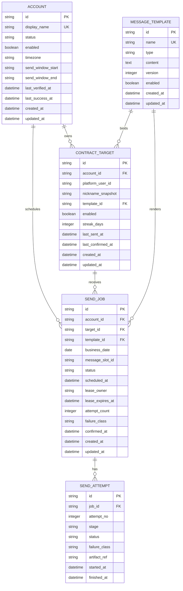

# Flame Contractor SQLite Schema 规格

> 本文描述 0.1.0 骨架期核心表。实际建表由 SQLModel metadata 完成。

## 1. 关系图



## 2. 约束

### account

- `display_name` 全局唯一；
- 不存在 Cookie、密码、Token、Storage State 字段；
- 时间窗口由应用层校验 `HH:mm`。

### contract_target

- 外键 `account_id → account.id`；
- 外键 `template_id → message_template.id`，可空；
- 骨架期唯一：`(account_id, nickname_snapshot)`；
- `streak_days >= 0` 由 API 和数据库 Check 共同限制。

### message_template

- `name` 全局唯一；
- `type` 骨架期固定为 `text`；
- `version >= 1`；
- 内容只允许白名单变量，应用层验证。

### send_job

核心唯一约束：

```sql
UNIQUE (account_id, target_id, business_date, message_slot_id)
```

该约束是防重复的最终边界，即使 Scheduler 重复运行也不得生成第二条同业务任务。

### send_attempt

```sql
UNIQUE (job_id, attempt_no)
```

同一 Job 的尝试序号不可重复。

## 3. SQLite 配置

连接建立时执行：

```sql
PRAGMA journal_mode=WAL;
PRAGMA foreign_keys=ON;
PRAGMA busy_timeout=5000;
```

理由：

- WAL 允许控制台读与调度写更好地并行；
- SQLite 默认不强制外键，必须显式开启；
- busy timeout 避免短暂写锁立即失败。

## 4. 迁移策略

骨架期使用 `SQLModel.metadata.create_all()`，只负责空库初始化，不承担生产结构升级。

进入 M2 前引入 Alembic，并生成第一份基线迁移。不得长期用 `create_all()` 冒充迁移系统。

## 5. 数据保留

建议默认值（下一阶段实现）：

- SendJob/Attempt：保留 180 天；
- 普通日志：30 天；
- 失败截图：14 天；
- Playwright Trace：7 天；
- `unknown_requires_review` 相关 artifact：人工处理前不自动删除。

任何清理策略不得删除账号 Profile 或会话凭据。
