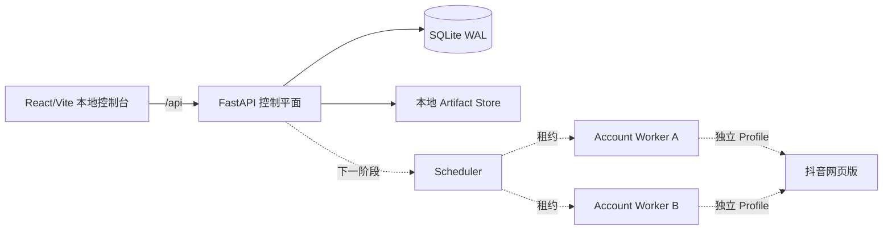
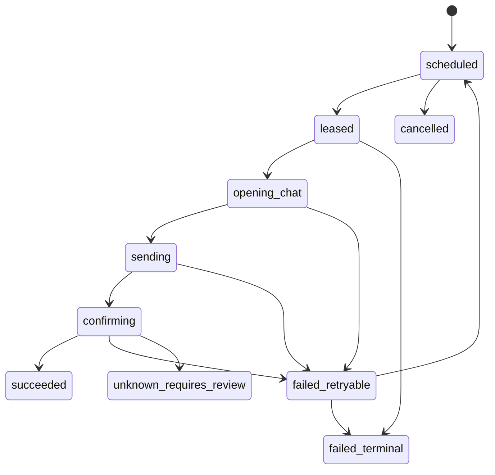

# Flame Contractor 技术设计

> 版本：0.1.0 | 目标：本机自用版骨架

## 1. 架构目标

- 在单机上可靠管理少量本人账号；
- 账号数据、任务状态和浏览器会话彼此隔离；
- 将“控制平面”和未来的“抖音执行器”解耦；
- 在引入真实自动化前，先建立正确的数据、幂等和状态边界；
- 保持代码足够简单，不提前引入分布式基础设施。

## 2. 总体架构



### 2.1 当前骨架

- `frontend/`：React + TypeScript + Vite；
- `backend/`：FastAPI + SQLModel + SQLite；
- `docs/`：PRD、技术设计、API 文档；
- `data/`：运行时 SQLite（被 Git 忽略）；
- `artifacts/`：后续脱敏截图/Trace（被 Git 忽略）。

### 2.2 下一阶段组件

- Scheduler：按发送窗口生成任务、租约与重试；
- Worker：每账号独立进程和浏览器 Profile；
- Douyin Adapter：selector、身份确认、输入和发送终态确认；
- Artifact Service：短期保存脱敏诊断文件。

## 3. 后端分层

```text
app/
├─ main.py              # 应用工厂、lifespan、CORS、路由注册
├─ core/
│  ├─ config.py         # 环境配置
│  └─ database.py       # engine、session、初始化
├─ models.py            # SQLModel 表和领域枚举
├─ schemas.py           # API 输入/输出模型
├─ services.py          # 业务校验与聚合
└─ api/
   ├─ router.py
   ├─ health.py
   ├─ dashboard.py
   ├─ accounts.py
   ├─ targets.py
   └─ templates.py
```

### 3.1 依赖选择

- FastAPI：API、OpenAPI 和依赖注入；
- SQLModel：小型项目中统一 Pydantic/SQLAlchemy 模型；
- SQLite WAL：本地单机、零运维；
- pytest + FastAPI TestClient：API 与 lifespan 测试。

不使用：Celery、Redis、消息队列、微服务框架。

## 4. 核心数据模型

### 4.1 Account

- 本地账号元数据；
- 当前骨架不含 Cookie、密码、Token 字段；
- 后续仅保存 `profile_ref`，由内部 Profile Store 解析真实路径；
- `display_name` 唯一。

### 4.2 ContractTarget

- 属于一个 Account；
- `platform_user_id` 获得后用于稳定身份匹配；
- 昵称仅为快照，不作为唯一身份依据；
- `(account_id, nickname_snapshot)` 在骨架阶段唯一，避免明显重复绑定；
- 后续可迁移为 `(account_id, platform_user_id)` 条件唯一。

### 4.3 MessageTemplate

- 稳定 UUID；
- 当前只允许 `text`；
- `content` 使用受控 Mustache 风格变量；
- `version` 每次修改递增（更新 API 后续实现）。

### 4.4 SendJob

- 一个“业务日期下的目标 + 消息槽位”任务；
- 唯一约束：

```text
(account_id, target_id, business_date, message_slot_id)
```

- 状态机：



### 4.5 SendAttempt

- 每次真实尝试独立记录；
- 记录阶段、开始/结束、失败分类和 artifact 引用；
- 不记录消息正文、Cookie 或 Storage State。

## 5. 幂等与租约

### 5.1 创建幂等

数据库唯一约束是最终防线；应用层先查询只用于友好提示，不能替代唯一约束。

### 5.2 执行租约（下一阶段）

- Scheduler 原子地将 `scheduled` 更新为 `leased`；
- 写入 `lease_owner`、`lease_expires_at`；
- 同一账号需额外账号互斥租约；
- worker 定期 heartbeat；
- 租约过期且发送阶段尚未开始可重排；
- 已进入 `sending/confirming` 后 worker 丢失，转为 `unknown_requires_review`，不可自动重发。

## 6. 账号隔离

下一阶段每个账号使用：

```text
data/profiles/<account-id>/
artifacts/<account-id>/<job-id>/
```

但数据库和 API 只暴露逻辑 `profile_ref`，不接受用户提交任意文件系统路径。

隔离级别：

1. 独立浏览器 Profile；
2. 独立 Worker 进程；
3. 独立任务租约；
4. 日志带账号别名而非真实敏感信息；
5. 一个账号崩溃不终止 Scheduler/API。

## 7. 安全边界

### 7.1 当前骨架

- API 只监听开发配置指定地址；生产本地模式默认 `127.0.0.1`；
- CORS 只允许本地前端来源；
- Account API 明确禁止凭据字段（Pydantic `extra="forbid"`）；
- 不把数据库、artifact、`.env` 提交 Git；
- 日志使用结构化、白名单字段。

### 7.2 会话凭据（下一阶段）

- 优先持久浏览器 Profile，不要求用户手工粘贴 Cookie；
- Profile 目录仅本机用户可读；
- 如果导出 Storage State，使用操作系统密钥环派生密钥加密；
- API 永不返回凭据内容；
- 日志和异常统一秘密扫描/脱敏。

### 7.3 明确禁止

- 自动过验证码；
- 修改浏览器指纹规避检测；
- 接受账号密码并代登录；
- 将会话上传到远端；
- 模糊匹配后直接发送。

## 8. 前端设计方向

### 8.1 主题依据

产品核心不是“营销自动化”，而是“守护若干每日契约”。界面采用**契约炉心控制台**：将账号视为炉心、好友关系视为契约，运行状态以克制的火焰温度表达。

### 8.2 视觉 Token

- `Coal` `#0B0D10`：主背景；
- `Iron` `#15191F`：面板；
- `Ash` `#8B949E`：次级文字；
- `Parchment` `#F2EDE4`：主文字；
- `Ember` `#FF6A3D`：主要动作/健康焰；
- `Gold` `#F5B942`：等待与警告；
- `Cyan` `#72D6D0`：信息/可验证状态；
- `Crimson` `#E45B64`：失败。

字体：

- 展示标题：`STKaiti` / `KaiTi` 回退，少量使用，建立中文契约气质；
- 正文：系统无衬线栈，确保本地零字体依赖；
- 数据：`Cascadia Code` / `Consolas`。

### 8.3 页面结构

不是传统左侧大导航后台，而是窄顶栏 + 双栏炉心布局：

```text
┌ 品牌 / 当前日期 / 系统健康 / 新建账号 ┐
├ 今日焰线（主叙事与进度） ── 待处理 ┤
├ 账号炉心列表 ─────────── 最近任务 ┤
└ 下一阶段能力提示 / 隐私边界 ─────┘
```

**签名元素**：页面中心的“今日焰线”是一条由契约节点组成的横向进度轨道，而不是通用 KPI 卡片堆。每个节点代表真实契约状态。

设计自检：避免常见的紫色渐变 SaaS、简单换色 Admin 模板和过度中二装饰。火焰语言只集中在焰线与品牌标题，其余界面保持生产工具的克制。

## 9. API 与错误处理

- API 前缀：`/api`；
- JSON 使用 UTF-8；
- 失败统一使用 FastAPI `detail`，骨架阶段保持简单；
- 业务冲突返回 `409`；
- 不存在返回 `404`；
- 输入校验返回 `422`；
- OpenAPI：`/docs`。

## 10. 测试策略

### 后端

- lifespan 自动建表；
- health；
- 创建/列出账号；
- 重复账号 409；
- 非法状态/额外凭据字段 422；
- 创建模板与契约对象；
- dashboard 聚合真实数据；
- SendJob 唯一约束单元测试。

### 前端

本轮以：

- TypeScript 严格检查；
- Vite production build；
- API 错误/空状态人工视觉验证；
- 响应式截图验证（如时间允许）

作为骨架验收。交互增长后再引入 Vitest/Playwright，避免为当前静态骨架过度搭建。

## 11. 后续里程碑

1. **M1（本轮）**：控制平面骨架、核心 schema、API、仪表盘；
2. **M2**：单账号独立 Profile + 扫码登录 + Dry Run；
3. **M3**：严格好友绑定 + 纯文字发送终态确认；
4. **M4**：Scheduler + 多账号 Worker；
5. **M5**：原生表情、通知与诊断热修。
